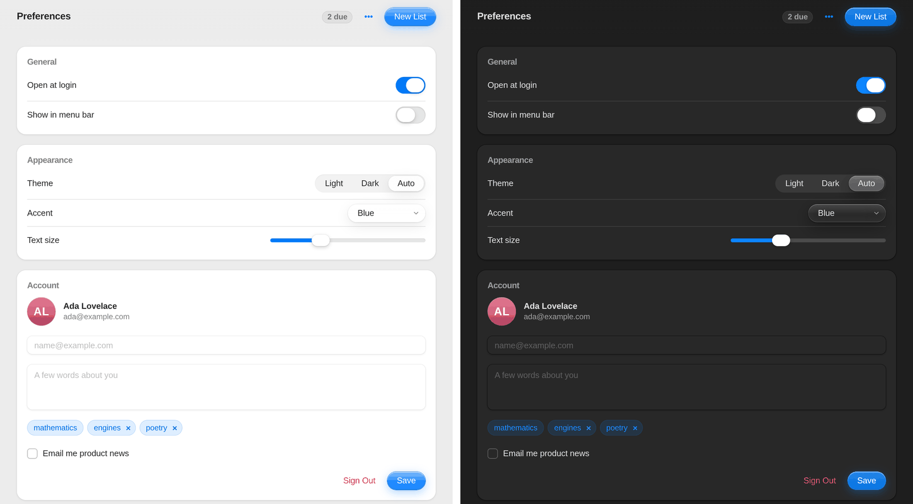
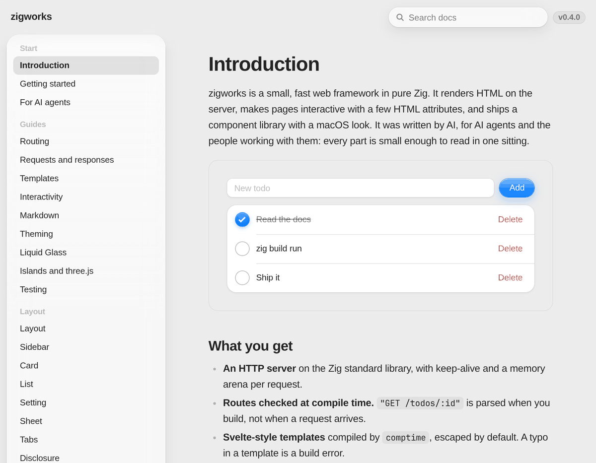

<div align="center">

# zigworks

**A small, fast web framework in pure Zig, written by AI for AI agents and the people working with them.**

HTTP server to CSS tokens in one dependency-free package: compile-time routes, Svelte-style templates,
htmx-style interactivity, and a Liquid Glass component library with a macOS look.

[](https://github.com/olibuijr/zigworks/actions/workflows/ci.yml)
[](https://github.com/olibuijr/zigworks/tags)
[](https://ziglang.org)
[](LICENSE)



</div>

## Highlights

- **Pure Zig, zero dependencies.** Standard library only: HTTP/1.1 with keep-alive and a memory arena per request.
- **Checked at compile time.** Routes like `"GET /todos/:id"` and templates are parsed when you build, so typos fail the build, not a request.
- **Server-rendered, works without JS.** z.js (about 18 KB with the glass runtime, ~7 KB gzipped) adds htmx-style requests and swaps with a few HTML attributes.
- **35 components.** macOS HIG defaults, Liquid Glass on controls (real refraction in Chromium), spring motion, light and dark mode.
- **Accessible by default.** Honours Reduce Motion, Reduce Transparency and Increase Contrast, uses no stock browser popups, and never zooms into fields on phones.
- **Islands for client JS.** Mount three.js or any ES module where you need it.
- **Small enough to read.** One component per file. Agents and people can hold the whole thing in their head.

## Quick start

Requires [Zig 0.17.1](https://ziglang.org/download/) (pinned in `mise.toml`; `mise install` sets it up).

```sh
git clone https://github.com/olibuijr/zigworks && cd zigworks
zig build run       # todo example on http://localhost:8080
zig build gallery   # every component in a preferences window
zig build docs      # the documentation site, built with zigworks
zig build scene     # three.js island
```

Apps listen on every interface (`0.0.0.0`) so they are reachable on your LAN. Set `PORT=...`, or
`HOST=127.0.0.1` to keep an app local.

### Use it in your project

```sh
zig fetch --save git+https://github.com/olibuijr/zigworks#v0.5.2
```

```zig
// build.zig
const zigworks = b.dependency("zigworks", .{ .target = target, .optimize = optimize });
exe.root_module.addImport("zigworks", zigworks.module("zigworks"));
```

<div align="center">

</div>

## An app

```zig
const std = @import("std");
const zw = @import("zigworks");

const app = .{
    .routes = .{
        .{ "GET /", index },
        .{ "POST /todos", create },
        .{ "DELETE /todos/:id", remove },
    },
    .css = ".todo{gap:8px}",   // optional, appended to /_zw/zw.css
    .tokens = .{},             // optional, override design tokens
};

pub fn main(init: std.process.Init) !void {
    try zw.serve(init, app, .{ .port = 8080 });
}

fn index(c: *zw.Ctx) !void {
    try c.page(zw.ui.layout(.{ .title = "Hello", .body = zw.view("<p>Hi {name}</p>", .{ .name = "you" }) }));
}
```

Request order: `/_zw/*` built-ins, then routes in order, then files in `public/`, then 404
(`app.not_found`, a handler, renders a custom 404 page). A handler that calls `c.pass()` without
responding hands the request to the next matching route, then to `public/`.
A handler that sends nothing answers 204. A handler error answers 500 and is logged.

## Routes

`"METHOD /path/:param/*"`. GET routes also answer HEAD. `*` (last segment) captures the rest as param `"*"`.
Patterns are checked at compile time.

## Ctx

| Read | |
|---|---|
| `c.param("id")` | route param, decoded |
| `c.query("q")` | query value, decoded |
| `c.form("title")` | urlencoded body field, decoded |
| `c.json(T)` | parse JSON body |
| `c.header("name")` | request header (case-insensitive) |
| `c.isPartial()` | request came from z.js: send a fragment |
| `c.method`, `c.path`, `c.body`, `c.arena`, `c.io` | |

| Respond (once) | |
|---|---|
| `c.page(component)` | HTML from any value with `render(self, *Writer)` |
| `c.html(src, data)` | inline template |
| `c.text(s)`, `c.sendJson(v)` | |
| `c.redirect("/")` | 303, or `z-redirect` header for z.js |
| `c.send(status, content_type, body)` | anything |
| `c.status = .created`, `c.setHeader(k, v)` | before responding |
| `c.pass()` | decline: next route, then `public/`, then 404 |

All memory from `c.arena` is freed after the response. Bodies over `Options.max_body` (1 MiB) get 413.

## Templates

Compiled at comptime; unknown variables and bad blocks are compile errors. Output is escaped.

```
{expr}                      escaped value: strings, ints, floats, bools, enums, optionals
{@html expr}                raw
{#if expr}..{:else}..{/if}  `!expr` negates; truthy = true, non-null, non-empty, non-zero
{#each list as x, i}..{/each}
{{                          literal {
```

`expr` is a path: `todo.title`, `todos.len`. A value with `render(self, *Writer)` is written raw: that's how components nest.

```zig
zw.view(src, data)            // a component from a template
zw.View(src, Data)            // its type, for return types
zw.each(items, rowFn)         // render rowFn(item) for each item; type zw.Each(Items, rowFn)
zw.props(T, .{...})           // build props with defaults; missing/unknown props are compile errors
```

## Components (`zw.ui`)

macOS HIG defaults with Liquid Glass on the functional layer (controls, menus, sheets, sidebar, search,
dialog); content is opaque. Glass refracts what is behind it (SVG displacement lenses per element size,
Chromium; blur elsewhere), has a specular rim and pointer light, and moves on spring curves: pressed
controls stretch and spring back, knobs swell into clear drops. Classes for your own markup:
`zw-glass`, `zw-glass--clear`, `zw-press`. See docs/pages/glass.md.
No stock browser UI: pickers replace `<select>`, a custom dialog replaces `confirm()`.

The main props are listed here; every component's docs page (`docs/pages/components/`) lists all of them.

| Component | Props (defaults) | Type |
|---|---|---|
| `layout` | title, body, brand="", toolbar, sidebar, head="" | `Layout(Toolbar, Sidebar, Body)` |
| `sidebar` | sections=[{title, links=[{label, href}]}], current, label="Navigation" | `Sidebar` |
| `card` | body, title="", z | `Card(Body)` |
| `list` | id, body, empty="Nothing here yet" | `List(Body)` |
| `setting` | label, control | `Setting(Control)` |
| `sheet` | id, title, body | `Sheet(Body)` |
| `callout` | body, kind=.note (note/tip/warning), title="" | `Callout(Body)` |
| `button` | label, variant=.secondary (primary/secondary/plain/destructive), type=.button, aria, opens, disabled, z | `Button` |
| `field` | name, label, placeholder, value, type="text", required, autofocus, z | `Field` |
| `check` | on, label, z | `Check` |
| `toggle` | name, label, on=false, z | `Toggle` |
| `segmented` | name, label, options=[{value,label,selected}], z | `Segmented` |
| `slider` | name, label, min=0, max=100, step=1, value=50, z | `Slider` |
| `picker` | id, name, label, options=[{value,label,selected}], z | `Picker` |
| `menu` | id, items=[{label, z, destructive, separated}] | `Menu` |
| `search` | action, label="Search", placeholder="Search", id="zw-results" | `Search` |
| `badge` | text, id, oob | `Badge` |
| `progress` | value (?u8, null = spinner), label | `Progress` |
| `table` | head=[]string, rows=[][]string | `Table` |
| `code` | src, lang="zig" (highlighted, Copy button) | `Code` |
| `island` | src, props="{}", height="360px", label | `Island` |
| `tabs` | id, labels=[]string, panels=.{ ... } (one per label), selected=0 | `Tabs(Panels)` |
| `disclosure` | title, body, open=false | `Disclosure(Body)` |
| `path` | items=[{label, href=""}], label="Path" (breadcrumb) | `Path` |
| `empty` | title, text="", action | `Empty(Action)` |
| `textarea` | name, label, placeholder, value, rows=3, required, z | `Textarea` |
| `stepper` | name, label, value=0, min=0, max=100, step=1, z | `Stepper` |
| `checkbox` | name, label, value="on", on=false, z | `Checkbox` |
| `radio` | name, label, options=[{value,label,selected}], z | `Radio` |
| `tooltip` | text, body, side=.above (above/below) | `Tooltip(Body)` |
| `tag` | text, remove (?Z: shows a remove button) | `Tag` |
| `avatar` | name, src="", size=32 (initials on a color from the name) | `Avatar` |
| `kbd` | keys ("⌘ K") | `Kbd` |
| `skeleton` | lines=3, label="Loading" | `Skeleton` |
| `toast` | text, kind=.info (info/success/error); return it from any handler | `Toast` |

Option and item types: `ui.SegmentedOption`, `ui.PickerOption`, `ui.MenuItem`, `ui.SidebarSection`, `ui.SidebarLink`.
A `sidebar` passed to `layout` makes a two-column app; on narrow screens it slides in from a title-bar button.
`zw.markdown` output is styled by `.zw-prose`; add `zw-not-prose` to a wrapper to keep those styles off components inside it.

`button(.{ .opens = "id" })` toggles a `menu` or `sheet` (Popover API + CSS anchor positioning, no JS).
`id`s used with `opens` must be valid CSS identifiers.

**Add a component:** follow the checklist in [docs/pages/agents.md](docs/pages/agents.md#add-a-component).

## z.js

Attributes on any element (or `ui.Z` as `.z` on components, or `{z}` inside a tag):

```
z-get|z-post|z-put|z-patch|z-delete="/url"   send a request (forms send their fields, inputs their name=value)
z-target="#id" | "closest li"                where to put the response (default: the element)
z-swap="inner|outer|beforeend|afterbegin|delete|none"
z-trigger="click|submit|change|input|load"   default: submit for forms, change for inputs, click otherwise
z-confirm="Delete all?"                      ask first (custom dialog)
z-keep                                       on a form: keep its values after a successful send
z-oob                                        on a response element with an id: replace that element anywhere
z-oob="beforeend"                            append its children to that element instead (toasts)
z-island="/mod.js" data-props='{"a":1}'      import the module, call default(el, props); return cleanup
```

Requests carry `z-request: 1`. Successful non-GET forms reset unless they carry `z-keep`; popovers close after an action.
Only content added by `beforeend`/`afterbegin` animates, so motion marks what changed.

## Markdown

`zw.markdown(src)` is a component: headings with anchors, lists, fenced code (Zig highlighted on
the server), `> [!NOTE|TIP|IMPORTANT|WARNING|CAUTION]` callouts, tables, rules, inline code/bold/emphasis/links.
Raw HTML is escaped and links are limited to http(s), mailto, relative and `#` URLs, so it is safe
for user input. `zw.markdownWith(src, fences)` lets `fences.fence(w, lang, body) !bool` render
custom fences (the docs turn ```` ```demo ```` into live components). `zw.highlight(w, "zig", src)` stands alone.

## Design tokens

`css.Tokens` fields become CSS variables (`radius_control` becomes `--radius-control`). `light`/`dark`
palettes use macOS semantic names (`window`, `content`, `label`, `secondary`, `separator`, `accent`...)
plus the glass material (`glass`, `glass_thick`, `glass_clear`, `glass_rim`, `glass_shadow`, `glass_sheen`,
`glass_glow`, `knob`) and follow `prefers-color-scheme`. Motion tokens are spring curves as CSS `linear()`:
`spring`/`dur` (~2% overshoot), `spring_bouncy`/`dur_bouncy` (~20%), `spring_snappy`/`dur_snappy`.
Reduce Transparency, Increase Contrast and Reduce Motion are honoured.

```zig
.tokens = .{ .radius = "12px", .light = blk: { var p = zw.css.light; p.accent = "#5e5ce6"; break :blk p; } },
```

## three.js

Put modules in `public/`, map bare imports with `layout(.{ .head = importmap })`, mount with `ui.island`.
See `examples/scene`. Vendor three into `public/` to run offline.

## Limits

- Listens on all interfaces by default: fine on a LAN, but on the open internet run behind a
  reverse proxy (one task per connection, no idle timeout) or set `HOST=127.0.0.1`.
- Static files are read into memory per request (64 MiB cap); no ETag or range requests yet.
- No TLS, HTTP/2, sessions or CSRF tokens; add them when an app needs them.

## Project layout

```
src/
  zigworks.zig  public API (start here)
  server.zig    HTTP/1.1 on std.http, keep-alive, one task per connection, per-request arena
  router.zig    comptime routes
  ctx.zig       request context and responses
  view.zig      templates, props(), each()
  markdown.zig  safe Markdown subset -> HTML, custom fences
  highlight.zig Zig syntax highlighting with std.zig.Tokenizer
  css.zig       design tokens -> CSS variables (macOS HIG defaults)
  static.zig    public/ files (JS modules, wasm, glb/gltf/hdr/ktx2, images, fonts)
  client/z.js   browser runtime: requests, swaps, islands
  client/glass.js  Liquid Glass runtime: refraction lenses, pointer light, press inertia
  client.zig    z.js + styles for what it creates
  ui.zig        component library index
  ui/*.zig      one component per file, each with its own css
examples/       todo (CRUD, works without JS), gallery (all components), scene (three.js)
docs/           documentation site: Markdown pages, live component demos, search
tests/e2e.mjs   Chromium over DevTools protocol, zero npm packages
```

## Testing

```sh
zig build test      # unit tests
zig build e2e       # browser tests over the DevTools protocol; screenshots in zig-out/e2e
```

The e2e suite needs Node 22+ and Chromium (`CHROMIUM=/path/to/browser` to pick one). It uses no npm
packages. It drives real clicks and presses in light and dark mode and at phone width, and fails on
any console error.

## Contributing

Issues and pull requests are welcome. Keep changes small and in the style of the code around them:

- One component per file in `src/ui/`, with its own CSS. A new component touches several files;
  the [checklist](docs/pages/agents.md#add-a-component) lists them all.
- `zig build test` and `zig build e2e` must pass. Add a test for new behaviour.
- Note user-facing changes in [CHANGELOG.md](CHANGELOG.md) ([Keep a Changelog](https://keepachangelog.com), [SemVer](https://semver.org)).

## Security

Please report vulnerabilities privately; see [SECURITY.md](SECURITY.md). Read [Limits](#limits)
before putting an app on the open internet.

## License

[MIT](LICENSE)
